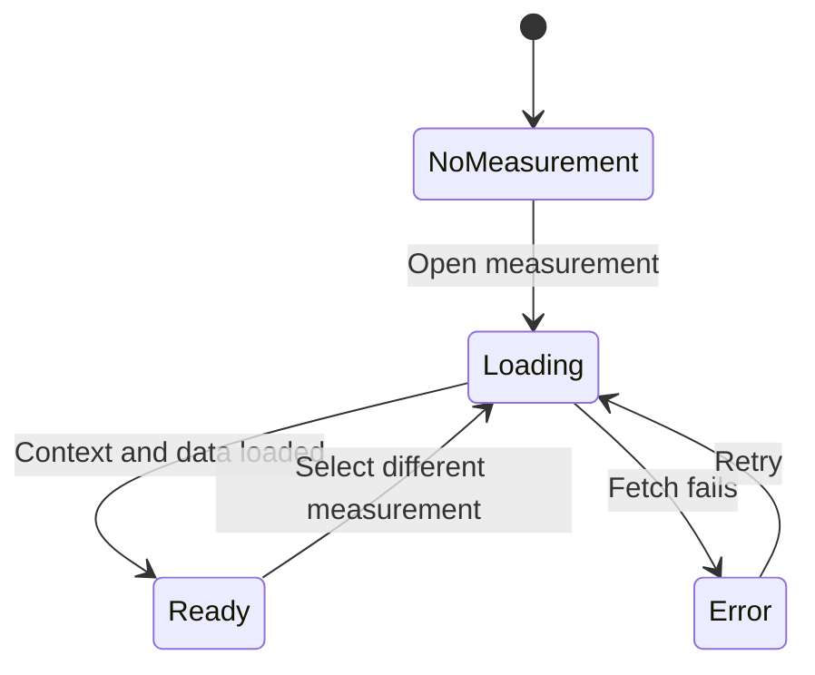
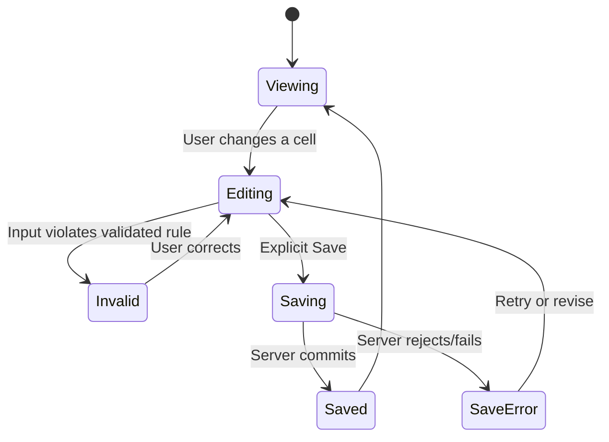

# 02 — Interaction and State Model

This file distinguishes **documented states** from **recommended implementation patterns**. It must not be mistaken for the current application's actual reducer or API schema.

## 1. State dimensions (do not collapse them)

| Dimension | Values evidenced in training | Why it matters |
|---|---|---|
| Workspace | Firm selected / not accessible | A firm determines user scope and available companies/funds. [S01] |
| Measurement | A company measurement date | Financial/ownership/valuation results are time-specific. [S02–S03] |
| Market date | Explicit market-data date (editable) | Comparative price points can refresh independently of measurement. [S07; S12] |
| Financial version | One or more financial versions | Different versions can feed different valuation scenarios. [S11–S12] |
| Cap Table version | Primary/secondary/other named versions | Security structure and associated Fund Ownership can differ. [S11–S12] |
| Fund Ownership version | Paired to Cap Table version (described 1:1) | Must not display ownership from the wrong capitalization scenario. [S12] |
| Valuation version | One or more valuation versions per date | Different sets of approaches on the same measurement date. [S12] |
| Breakpoint selection | Default or custom active | Waterfall computation uses the selected breakpoint set. [S05] |
| Method configuration | Calibration enabled/disabled | Calibrated method becomes read-only reference and is omitted from main valuation summary. [S07] |
| Publication/review | Draft / published / `ready for audit`; export also mentions `final` | Summary visibility and audit interaction differ by state. Transition diagram not confirmed. [S09; S12] |
| Request submission | Drafted, sent, responded (observed flow) | External respondent can answer/upload via emailed portal. [S12] |

**VERIFY:** The platform's exact enum values, state transitions and persistence are not recoverable from the notes. A teaching statement such as "published, draft, final" does not establish a full workflow graph.

## 2. Recommended view model (INFER — illustration only)

```ts
// Conceptual frontend view context, NOT an existing Scalar type.
type ValuationContext = {
  firmId: string;
  companyId: string;
  measurementId: string;
  measurementDate: string;      // date-only; exact serialization VERIFY
  marketDate: string | null;
  financialVersionId: string | null;
  capTableVersionId: string | null;
  ownershipVersionId: string | null;
  valuationVersionId: string | null;
  currency: string;
  breakpointMode: 'default' | 'custom';
};
```

Recommended: one canonical context per open workspace, and derived UI selectors. Changing the context invalidates downstream queries/results instead of silently reusing previous company/date/version state.

## 3. Key state transitions

### A. Measurement selection



**DOC:** Creating/selecting a measurement exposes the tables and menus for finance, securities and valuation. [S02; S13 @ 00:11:59]

**INFER:** Clear or visibly distinguish old data during loading; a selected measurement must not show stale computed values while its new context loads.

### B. Editable financial/capital grid



**DOC:** Speakers repeatedly invoked Save, and an August 1 exchange described a note not saved because the control was not obvious. [S06 @ 00:52:10; S04 @ 00:21:50]

**VERIFY:** Which fields autosave, which require page Save, whether editing creates an unsaved-change marker, and the actual atomicity of grid updates. **INFER recommendation:** clearly show dirty state and server-acknowledged success; require an unsaved-changes resolution before navigating to a different version.

### C. Valuation calculation and publication

```text
Configure inputs → [Recalculate / derive] → Inspect output
                    ↳ missing inputs: incomplete/blocked result (VERIFY UI)
                    ↳ method calibrated: reference-only, excluded from summary [DOC]
                    ↳ valid output: draft until published [DOC]
Draft → publish [DOC] → published visibility in applicable fund/summary views [DOC]
Draft/valuation → ready for audit [DOC] → auditor read-only [DOC]
```

**VERIFY:** The sequencing and permission checks between `ready for audit`, publish and final; whether valuation results recalculate instantly or only on Save; whether publication freezes a version or snapshots values. [S09 @ 00:20:29]

### D. Market-date update vs rollover

| User action | Documented effect | Keep separate from |
|---|---|---|
| Edit **Market Date** | Refresh public market price/metrics to selected date. [S06 @ 00:54:33] | Creating new measurement; changing historical record dates |
| **Bulk Action** market-date update | Update market data for multiple companies at selected date without full rollover. [S12 @ 00:24:33] | Rollover, financial version clone |
| **Rollover** | Carry measurement data into future measurement; may refresh market data unless `keep market data`; can omit valuation/documents. [S11–S12] | In-place edit of previous measurement |

Never reinterpret a market-data refresh as re-dating original ownership transactions.

## 4. Dependency changes and recomputation responsibilities

| Change trigger | Documented downstream concern | Agent contract |
|---|---|---|
| Change security series/terms or Cap Table version | Breakpoints, Fund Ownership pairing, SSV and allocation may change. [S03–S05; S11–S12] | Invalidate affected computations and ensure correct paired versions. |
| Change fund investment share count/price/date | Cost basis, ownership and returns may change. [S04] | Recompute from authorized source values; do not guess formula. |
| Change financial version or financial fields | Multiples, External Valuation, DCF and valuation summary may change by approach. [S03; S07–S10; S12] | Re-run dependent methods only; identify selected version in results. |
| Toggle custom breakpoints | Waterfall uses selected breakpoint set. [S05 @ 00:32:40] | Show active set and recalc when configuration is confirmed. |
| Change comparable companies or their market date | Public Comps statistics/multiples change. [S06 @ 00:20:30–00:54:33] | Distinguish fetched market data, manual overrides and retrieval date. |
| Edit approach weights | Aggregate equity valuation and resulting per-share allocations change. [S08–S10] | Enforce sum exactly 100% at validated decimal precision. |
| Change allocation method or volatility/maturity | Allocation per series can change. [S09–S10] | Recompute via verified model; show assumptions and derived output. |
| Switch valuation version | May select a different set of valuation approaches. [S12 @ 00:08:31] | Never show old version's methods or cached results as the new selection. |
| Publish valuation | Draft values become available in summary/fund report contexts. [S09 @ 00:20:29] | Refresh relevant projections; distinguish live recalculation from frozen published snapshot (VERIFY). |

## 5. UX feedback from training (observations vs proposals)

| Issue/feedback | What was said | Correct treatment |
|---|---|---|
| Ambiguous active breakpoints | Presenter suggested displaying whether default or custom breakpoints drive Waterfall. [S05 @ 00:36:29] | **DESIGN PROPOSAL**, not proven shipped UI. |
| Save discoverability | A note was not saved; explicit Save interaction was not obvious. [S06 @ 00:52:10] | **UX ISSUE/PROPOSAL**: visible dirty/saved/error feedback. |
| Stale UI after version switch | Data appeared only after page refresh. [S11 @ 00:45:58; S12] | **BUG-2025**, not intentional loading pattern. |
| Post-upload portal confirmation failed | Secure portal broke after responding/uploading, even in production test. [S12 @ 00:46:16–00:56:10] | **BUG-2025**; never infer upload failed merely from broken confirmation. |

## 6. Cross-cutting component state vocabulary (INFER)

Implement a consistent state vocabulary for each asynchronous component: `idle`, `loading`, `empty`, `ready`, `dirty`, `saving`, `saved`, `validationError`, `serverError`, `forbidden`, `stale`. Use actual design-system terminology when available. **Empty is not zero**: an omitted financial field, a computed zero, a missing comparable data point and a draft valuation excluded from a report are four different situations.
