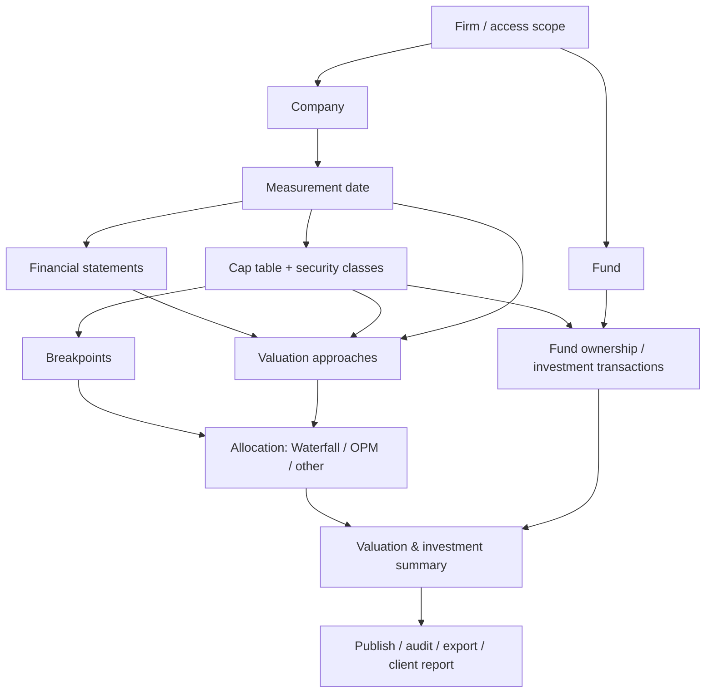

> **Reference only — imported 2026-10-27.** This folder is the *Scalar Product Logic & AI Agent Guide*
> distilled from the 2025 training-session notes (S01–S13). It is dated evidence, not the current spec.
> The working contract for this repo is [`../domain-logic.md`](../domain-logic.md) and
> [`AI-GUIDE.md` §11](../../../AI-GUIDE.md#11-product-logic-rules). Where these notes disagree with the
> current Figma frames or the design-system contract, the frames and the contract win.

# Scalar — Product Logic and Component Behavior Guide

**Evidence baseline:** 13 Google Gemini session-note DOCX files dated 2025-07-21 through 2025-08-20. These documents include meeting summaries and (except the first session) transcribed conversations. **Video recordings have not been reviewed.** This is a documentation of training-era behavior and narrated intent, *not* confirmation of the present production implementation.

## Who should use this

Product designers, frontend/backend engineers, QA, and AI coding agents (Cursor, Codex, Claude Code) implementing or modifying the Scalar valuation experience. The goal is to preserve **financial relationships, data dependencies and user-facing interaction semantics**, not to copy screenshots blindly.

## Start here

1. **`AGENTS.md`** — mandatory implementation rules, evidence discipline and change protocol.
2. **`01-PRODUCT-MODEL.md`** — product goal, users, hierarchy, terminology, and end-to-end mental model.
3. **`02-INTERACTION-STATE-MODEL.md`** — state machines, dependency propagation, draft/published behavior.
4. **`03-COMPONENT-CONTRACTS.md`** — component-by-component behavior and expected event contracts.
5. **`07-VALUATION-METHODS.md`** — documented financial methodologies and forbidden mathematical assumptions.
6. **`08-VERSIONS-AND-ROLLOVER.md`** — measurement, market date, versions and copy-forward rules.
7. **`09-DOCUMENTS-REPORTING-409A.md`** — documents, secure requests, exports and reports.
8. **`06-IMPLEMENTATION-AND-TESTS.md`** — acceptance criteria and integration-test plan.
9. **`05-EVIDENCE-REGISTER.md`** — source register and citations.
10. **`10-RISKS-AND-OPEN-QUESTIONS.md`** — uncertain specifications and historic defects.
11. **`04-VIDEO-AUDIT-PROTOCOL.md`** — instructions for reconciling future recordings.
12. **`11-SESSION-CROSSWALK.md`** — a session-by-session topic index.

## Evidence marks

| Mark | Meaning | Agent action |
|---|---|---|
| `DOC` | Described or demonstrated in training notes/transcription | Can model as **historical documented behavior**; confirm current product before changing finance-critical paths |
| `INFER` | Proposed engineering interpretation consistent with notes | Treat as recommended implementation pattern, **not** a historical product requirement |
| `VERIFY` | Ambiguous, unobserved, conflicting, or pending video review | Do not hard-code financial behavior; ask for verification |
| `BUG-2025` | Defect observed in a training environment in 2025 | Regression-test; **never intentionally reproduce the bug** |

Citations such as `[S06 @ 00:16:18]` refer to the Gemini notes/transcription from that session, as indexed in `05-EVIDENCE-REGISTER.md`. Timestamps originate from those documents and may be approximate. Filenames and IDs are intentionally preserved for traceability.

## Core product dependency map

The arrows are **conceptual dependencies**, not a validated backend schema or calculation order. In particular, which methods read financials versus cap tables is method-dependent. [S03, S04, S06, S10]

## Boundaries

**Documented:** Measurement/market date semantics; multiple Cap Table/financial/valuation versions; funds and ownership; financial tables; several valuation methods; allocation; publishing; document requests; 409A dashboard; Excel export; rollover.

**Not validated:** Exact backend formulas, REST/GraphQL endpoints, TypeScript interfaces, numeric precision, permission matrix, field-by-field UI design, present-day behavior, successful PDF generation from within the platform, or final resolution of historic defects. The session notes contain automated-transcription mistakes and examples made with test data.
